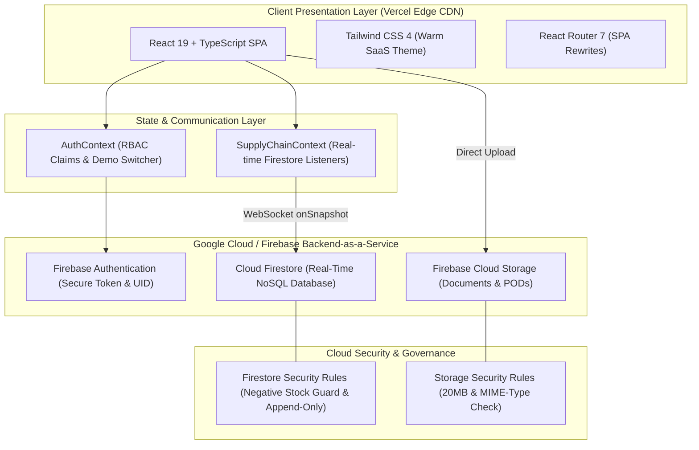

# RouteSync: Cloud-Based Supply Chain Tracking and Management System
## Academic Project Report & Viva Demonstration Guide
**Domain:** Transportation & Supply Chain Management | Cloud Computing & Full-Stack Application Development  
**Academic Guidelines Compliance:** CCSA Guidelines for Cloud-Based Full Stack Application Development Projects  

---

## 1. Project Title
**RouteSync: Cloud-Based Multi-Stakeholder Supply Chain Visibility and Consignment Tracking System with Real-Time State Synchronization and Role-Based Access Control**

---

## 2. Problem Statement
Global logistics networks and supply chain corridors face critical fragmentation across multi-enterprise handovers:
- **Visibility Black Holes:** Consignments passing between manufacturers, logistics transporters, intermediary warehouses, and retail outlets frequently experience blind spots where custody status, location, and condition are unknown.
- **Audit Tampering & Disputes:** Paper waybills and spreadsheets allow retroactively rewritten records, leading to unresolved claims regarding transit delays, lost cartons, and damaged cargo.
- **Inventory Mismatch & Stock Discrepancies:** Warehouses and retail distribution centres suffer from out-of-sync stock counts, negative inventory anomalies, and lack of real-time visibility into inbound vs. dispatched quantities.
- **Multi-Tenant Authorization Failures:** Traditional centralized logistics portals fail to enforce strict data boundaries between independent commercial partners, exposing confidential manifests or allowing unauthorized personnel to alter delivery statuses.
- **High-Latency Synchronization:** Existing ERP tools require manual page refreshes or periodic batch synchronization, leading to stale tracking dashboards and delayed operational interventions during transit bottlenecks.

---

## 3. Existing System and Its Limitations
### Existing Supply Chain & Freight Tracking Systems:
1. **Manual Paper Manifests & Excel Ledgers:**
   - Prone to human error, physical loss, illegible driver signatures, and complete absence of real-time tracking across geographic regions.
2. **Monolithic Enterprise Resource Planning (ERP) Systems (SAP, Oracle):**
   - Prohibitive licensing and compute costs for medium-sized logistics carriers and retail franchises.
   - Heavy relational database bottlenecks, slow page load times, and lack of persistent bidirectional WebSocket streaming for mobile or browser clients.
3. **Point-to-Point Carrier Portals (FedEx, UPS standalone trackers):**
   - Provide only post-facto milestones rather than collaborative multi-party custody handovers.
   - Do not provide integrated warehouse stock matrix calculations, dynamic discrepancy guards, or role-based document repositories for invoices, customs clearance, and proof of delivery (POD).

---

## 4. Proposed Solution
**RouteSync** is a cloud-native, real-time supply chain management and visibility platform built upon modern cloud infrastructure:
- **Reactive Real-Time Synchronization:** Leverages Cloud Firestore real-time listeners (`onSnapshot`) to deliver sub-second state propagation across all 6 stakeholder nodes without manual polling or browser refreshes.
- **Append-Only Digital Custody Ledger:** Employs an immutable subcollection architecture (`/shipments/{id}/events`) where chronological handover events cannot be edited or deleted once recorded, guaranteeing cryptographic chain-of-custody integrity.
- **Six-Role Role-Based Access Control (RBAC):** Supports 6 differentiated supply chain personas (**Manufacturer**, **Distributor**, **Warehouse Manager**, **Transporter**, **Retailer**, and **Administrator**), enforced through server-side Firestore and Storage Security Rules. Client-side self-elevation to admin is strictly prevented.
- **Strict Negative Inventory Prevention:** Enforces stock conservation guards at both the service layer and database security rule layer (`availableQuantity >= 0`), ensuring reliable inventory reconciliation.
- **Scalable Object Storage:** Firebase Cloud Storage for high-resolution bills of lading, commercial invoices, and digital Proof of Delivery (POD) images with strict MIME-type and 20MB payload validation.
- **Edge-Optimized Single Page Application (SPA):** Built with React 19, Vite, TypeScript, and Tailwind CSS, deployed on Vercel's global Edge Network with automated SPA rewrite rules and asset caching headers.

---

## 5. Project Objectives
1. Design and deploy a responsive, cloud-native logistics web platform in the **Transportation and Supply Chain** domain.
2. Implement **real-time bi-directional synchronization** for consignment dispatch manifests, location checkpoints, warehouse stock counts, and emergency delay broadcasts.
3. Enforce **least-privilege cloud security** using server-side Security Rules across Cloud Firestore and Firebase Cloud Storage.
4. Establish trusted **Role-Based Access Control (RBAC)** guaranteeing that participants only perform actions authorized for their supply chain node, complemented by an in-app Evaluator Switcher for academic examination.
5. Demonstrate core cloud computing concepts: Multi-Tenancy, Backend-as-a-Service (BaaS), Append-Only Audit Logging, Edge Delivery, and Offline-Aware Client Caching.
6. Achieve zero-downtime production deployment on **Vercel** with full SPA rewrite configuration and secure environment variable handling.

---

## 6. Target Users & Stakeholders
1. **Manufacturer:** Dispatches manufactured batches, registers product SKUs, defines batch numbers, and monitors outbound carrier pickup.
2. **Distributor:** Orchestrates regional wholesale orders, assigns transport fleets, and manages inter-depot transit.
3. **Warehouse Manager:** Supervises depot hubs, verifies cargo arrival counts, performs stock cycle adjustments, and audits quarantine/damaged stock.
4. **Transporter (Carrier):** Operates logistics fleets, updates physical checkpoint locations in real time, and logs transit delays or weather exceptions.
5. **Retailer:** Verifies final delivery receipts, confirms received quantities, inspects goods, and signs digital Proof of Delivery (POD).
6. **Administrator:** Governs network topology, reviews audit telemetry, configures routing protocols, and provisions trusted roles.

---

## 7. Functional Requirements
- **FR1: User Authentication & Role Assignment:** Email/password authentication via Firebase Auth with trusted Firestore profile persistence and non-client-elevated roles.
- **FR2: Product Catalog & SKU Management:** Creation, editing, and deletion of products with SKU, category, batch number, unit of measure, and active consignment deletion guards.
- **FR3: Shipment Consignment Management:** Registration of unique consignments with auto-generated tracking numbers (`RS-YYYY-XXXX`), origin, destination, assigned stakeholders, dispatch date, and expected delivery date.
- **FR4: Real-Time Shipment Journey & Tracking:** Interactive chronological timeline displaying append-only handover events, author signature, physical location, quantity handled, and status pills.
- **FR5: Tracking ID Search:** Fast query lookup by Waybill/Tracking Number with instant retrieval of verified chain-of-custody history.
- **FR6: Warehouse Inventory Matrix:** Real-time stock calculation tracking available, incoming, dispatched, and damaged inventory with negative quantity prevention.
- **FR7: Inventory Audit Ledger:** Append-only change history logging delta, reason, timestamp, and responsible operator.
- **FR8: Document & POD Cloud Storage:** Upload, preview, and download of bills of lading, invoices, transport permits, and delivery receipts up to 20MB.
- **FR9: Checkpoint Milestone Tasks:** Handover checklists and inspection milestones assigned to specific supply chain roles with priority tagging.
- **FR10: Shipment Calendar:** Calendar view mapping planned carrier dispatches and estimated delivery arrivals.
- **FR11: Operational Alerts & Broadcasts:** Real-time notification stream for route delays, urgent dispatches, and low stock thresholds.
- **FR12: Telemetry & Analytics:** Pipeline status distribution, fulfillment percentage, carrier throughput share, and catalog breakdown.
- **FR13: Admin Control Tower & Viva Switcher:** Live role switcher enabling examiners to test UI and data permissions across all 6 roles.

---

## 8. Non-Functional Requirements
- **NFR1: Real-Time Latency:** State changes in Firestore must reflect on connected subscriber clients in under 500ms over WebSocket connections.
- **NFR2: High Availability:** Built on Google Cloud's multi-region Firestore architecture with documented 99.999% SLA.
- **NFR3: Security & Authorization:** Multi-tenant isolation enforced via server-side Firestore Rules. Secret keys and service accounts are never exposed to client code.
- **NFR4: Reliability & Data Integrity:** Append-only timeline ensures historical custody records cannot be overwritten or wiped.
- **NFR5: Offline Resilience:** Firestore client-side offline persistence caches reads and queues optimistic writes until network connectivity resumes.
- **NFR6: Responsive Design:** Modern, warm SaaS UI adhering to Dribbble aesthetic standards with full mobile and desktop support.

---

## 9. System Architecture

---

## 10. Technology Stack
- **Frontend Framework:** React 19, TypeScript
- **Build Tool:** Vite 6
- **Styling & Design System:** Tailwind CSS 4 with custom warm palette (#FFC436, #FF4D88, #5B4BD8, #4FA8FF, #FF6433, #2C264D)
- **Icons:** Lucide React
- **Cloud Backend:** Google Cloud Firebase (Modular SDK v13)
- **Database:** Cloud Firestore (Document NoSQL)
- **Authentication:** Firebase Authentication
- **Object Storage:** Firebase Cloud Storage
- **Cloud Hosting:** Vercel Global Edge Network with custom SPA rewrite rules

---

## 11. Firebase Cloud Services Used
1. **Firebase Authentication:** Handles user sign-up, sign-in, session token lifecycle, and secure UID extraction.
2. **Cloud Firestore:** Root collections for `shipments`, `products`, `inventory`, `shipmentDocuments`, `deliveryTasks`, `notifications`, and subcollections for `shipments/{id}/events`.
3. **Firebase Cloud Storage:** Bucket storage under `shipments/{shipmentId}/*` for tamper-evident transport documents and proof of delivery images.
4. **Cloud Security Rules:** Declarative authorization rules enforcing role boundaries, append-only constraints, and negative quantity guards.

---

## 12. Cloud Computing Concepts Demonstrated
1. **Backend-as-a-Service (BaaS):** Eliminates traditional dedicated VM server maintenance by offloading database scaling, auth, and storage to managed Google Cloud infrastructure.
2. **Real-Time Data Streaming (Reactive Systems):** Persistent duplex WebSockets synchronize consignment and inventory updates to active browser clients without polling.
3. **Multi-Tenancy & Role-Based Access Control (RBAC):** Differentiated access boundaries for 6 enterprise partner types within a single shared cloud database.
4. **Append-Only Distributed Ledger Pattern:** Immutable timeline architecture preserving chronological proof of handovers.
5. **Content Delivery Network (CDN) & Edge Hosting:** Static assets and SPA bundle delivered from geographically proximate Vercel edge points.
6. **Optimistic Local Caching:** Local cache guarantees uninterrupted UI interaction during network intermittency, syncing queued mutations upon reconnect.

---

## 13. Database Schema Design (Cloud Firestore)

### Collection: `users`
- `uid` (string, Document ID): Unique Firebase Auth UID
- `displayName` (string): Representative name
- `email` (string): Corporate email
- `role` (string): `manufacturer` | `distributor` | `warehouse_manager` | `transporter` | `retailer` | `admin`
- `organizationName` (string): Registered business name
- `phone` (string): Contact number
- `location` (string): Physical headquarters / depot
- `createdAt` (timestamp): Registration date

### Collection: `shipments`
- `id` (string, Document ID): Auto-generated unique ID
- `trackingNumber` (string, Indexed): Waybill format `RS-YYYY-XXXX`
- `productId` (string): Associated catalog product
- `productName` (string): Item description
- `sku` (string): SKU code
- `quantity` (number): Number of units
- `unit` (string): e.g. units, pallets, crates
- `source` (string): Origin factory / terminal
- `destination` (string): Receiving retail / distribution facility
- `currentLocation` (string): Last verified physical checkpoint
- `manufacturerId` (string): Creating partner UID
- `transporterName` (string): Carrier company
- `warehouseName` (string): Transit depot
- `retailerName` (string): Receiving client
- `status` (string, Indexed): `Created` | `Processing` | `Dispatched` | `In Transit` | `Arrived at Warehouse` | `Out for Delivery` | `Delivered` | `Delayed` | `Cancelled`
- `dispatchDate` (string): YYYY-MM-DD
- `expectedDeliveryDate` (string): YYYY-MM-DD
- `deliveredDate` (string, optional): Timestamp of completed handover
- `notes` (string): Handling instructions
- `createdAt`, `updatedAt` (timestamp)

### Subcollection: `shipments/{shipmentId}/events` (Append-Only)
- `id` (string): Auto ID
- `shipmentId` (string): Parent shipment ID
- `eventType` (string): Milestone name from `TRACKING_EVENT_TYPES`
- `location` (string): Verified physical facility
- `timestamp` (string): ISO 8601 audit timestamp
- `updatedByUid` (string): Actor UID
- `updatedByName` (string): Actor name
- `updatedByRole` (string): Actor role
- `quantity` (number): Quantity verified at this node
- `notes` (string): Inspection remarks
- `documentUrl` (string, optional): Associated POD image URL

### Collection: `products`
- `id` (string): Document ID
- `name` (string): Product title
- `sku` (string): SKU identifier
- `category` (string): Industry category
- `description` (string): Technical specs
- `quantity` (number): Catalog inventory
- `unit` (string): Units of measure
- `batchNumber` (string): Production batch
- `color` (string): Visual UI accent hex code
- `manufacturerId` (string): Producer UID

### Collection: `inventory`
- `productId` (string, Document ID): Matching product ID
- `productName` (string): Product name
- `sku` (string): SKU code
- `warehouseLocation` (string): Depot hub
- `availableQuantity` (number): Ready stock (Guarded >= 0)
- `incomingQuantity` (number): En route from suppliers
- `dispatchedQuantity` (number): En route to retail
- `damagedQuantity` (number): Quarantine scrap count
- `minThreshold` (number): Safety stock trigger
- `updatedAt` (timestamp), `updatedByName` (string)

### Collection: `inventoryAuditLogs` (Append-Only)
- `id` (string): Document ID
- `productId` (string): Product SKU reference
- `timestamp` (timestamp): Exact modification instant
- `userId` (string), `userName` (string): Responsible operator
- `reason` (string): Operational explanation
- `delta` (object): Quantity changes applied

### Collection: `shipmentDocuments`
- `id` (string): Document ID
- `shipmentId` (string): Associated shipment
- `trackingNumber` (string): Quick waybill reference
- `title` (string): Document display title
- `type` (string): `Invoice` | `Delivery Receipt` | `Transport Document` | `Purchase Order` | `Product Image` | `Proof of Delivery`
- `fileName` (string): Original file name
- `fileSize` (number): File size in bytes
- `storagePath` (string): Cloud Storage path
- `downloadURL` (string): Secure HTTPS download URL
- `uploadedByUid` (string), `uploadedByName` (string): Uploader
- `uploadedAt` (timestamp)

---

## 14. Cloud Security Considerations
1. **Server-Side Firestore Rules:** Security rules validate incoming documents prior to write execution. Role permissions are enforced using database-level lookups (`getUserData().role`).
2. **Client-Side Role Elevation Prevention:** Rule `(!request.resource.data.diff(resource.data).affectedKeys().hasAny(['role', 'email']))` prohibits users from editing their role field to gain admin privileges.
3. **Database-Level Negative Stock Invariant:** Inventory rules enforce `request.resource.data.availableQuantity >= 0` to prevent data corruption.
4. **Tamper-Evident Append-Only Constraint:** `match /events/{eventId} { allow update, delete: if false; }` ensures history cannot be altered.
5. **No Frontend Secret Leakage:** Firebase Admin SDK service account credentials are never bundled in client code. Only public client configuration is used.

---

## 15. Deployment Procedure (Vercel)
1. **Source Repository Connection:** Commit codebase to GitHub repository.
2. **Vercel Project Setup:** Import repository as Vite project.
3. **Environment Configuration:** Configure `VITE_FIREBASE_API_KEY`, `VITE_FIREBASE_AUTH_DOMAIN`, `VITE_FIREBASE_PROJECT_ID`, `VITE_FIREBASE_STORAGE_BUCKET`, `VITE_FIREBASE_MESSAGING_SENDER_ID`, and `VITE_FIREBASE_APP_ID`.
4. **SPA Rewrite Verification:** Verify `vercel.json` rewrites all route requests to `/index.html` to support client-side routing.
5. **Production Build:** Execute `npm run build` producing optimized `dist/` bundle.
6. **Live Domain Verification:** Test real-time synchronization and image uploads directly on the production Vercel URL.

---

## 16. Limitations
1. **Simulated Hardware Telemetry:** Physical GPS sensor coordinates are currently logged via authorized user actions and terminal checkpoints rather than real-time vehicle IoT dongles.
2. **Cloud Storage Free Quota:** Standard Firebase Spark tier limits free bandwidth and storage capacity.
3. **Third-Party Carrier APIs:** Carrier integration operates via direct platform participation rather than automated EDI 214/315 integrations with legacy legacy carriers.

---

## 17. Future Enhancements
1. **IoT Sensor & GPS Hardware Integration:** Connect OBD-II GPS dongles and BLE temperature loggers for automated in-transit condition tracking.
2. **Automated Blockchain Notarization:** Anchor daily shipment hashes to an Ethereum or Polygon L2 network for cross-enterprise cryptographic verification.
3. **Predictive Delivery & Delay Forecasting:** Train machine learning models on historical weather and route data to forecast delivery delays before departure.
4. **Automated QR & Barcode Generation:** Generate printable QR code labels for cartons and pallets that open the Live Tracking page directly when scanned.

---

# RouteSync: 10-Step Viva Demonstration Plan

During the academic project demonstration or viva evaluation, execute the following 10-step sequence to showcase compliance with CCSA guidelines:

| Step # | Demonstration Milestone | Target Feature / Screen | Cloud & Technical Concept Demonstrated |
| :--- | :--- | :--- | :--- |
| **Step 1** | **User Registration & Organization Login** | `/signup` and `/login` | Firebase Authentication, user document creation with organization credentials and initial role assignment. |
| **Step 2** | **Product SKU Registration** | `/products` ("Register Product") | Cloud Firestore write to `/products`, candy card UI rendering, SKU & batch assignment. |
| **Step 3** | **Dispatch New Consignment** | `/shipments` ("New Shipment") | Auto-generated tracking ID (`RS-2026-XXXX`), initial event creation, automatic inventory dispatch adjustment. |
| **Step 4** | **Live Journey & Waybill Search** | `/track` (Search Tracking ID) | Real-time query retrieval, 5-stage visual progress stepper, origin-to-destination route banner. |
| **Step 5** | **Append-Only Handover Logging** | `/track` ("Log Custody Movement") | Real-time `onSnapshot` event listener, append-only security rule enforcement, physical checkpoint tracking. |
| **Step 6** | **Proof of Delivery (POD) Cloud Upload** | `/documents` ("Upload Document") | Firebase Cloud Storage upload, MIME-type and 20MB validation, HTTPS preview/download link generation. |
| **Step 7** | **Warehouse Inventory & Negative Guard** | `/inventory` ("Adjust Stock") | Stock matrix update, strict negative inventory prevention validation, append-only audit trail logging. |
| **Step 8** | **Delivery Milestone & Inspection Tasks** | `/tasks` ("New Checkpoint") | Multi-role handover checklists, priority badges, completion toggling. |
| **Step 9** | **Real-Time Cross-Window Synchronization** | Split browser windows on `/track` | Real-time WebSocket synchronization without browser refreshes. |
| **Step 10** | **Academic Viva Evaluator Switcher** | `/admin` or `/settings` Role Switcher | Dynamic RBAC permission validation across all 6 roles without re-logging in. |

---
*Report prepared for CCSA Cloud Computing & Full Stack Academic Project Examination.*
