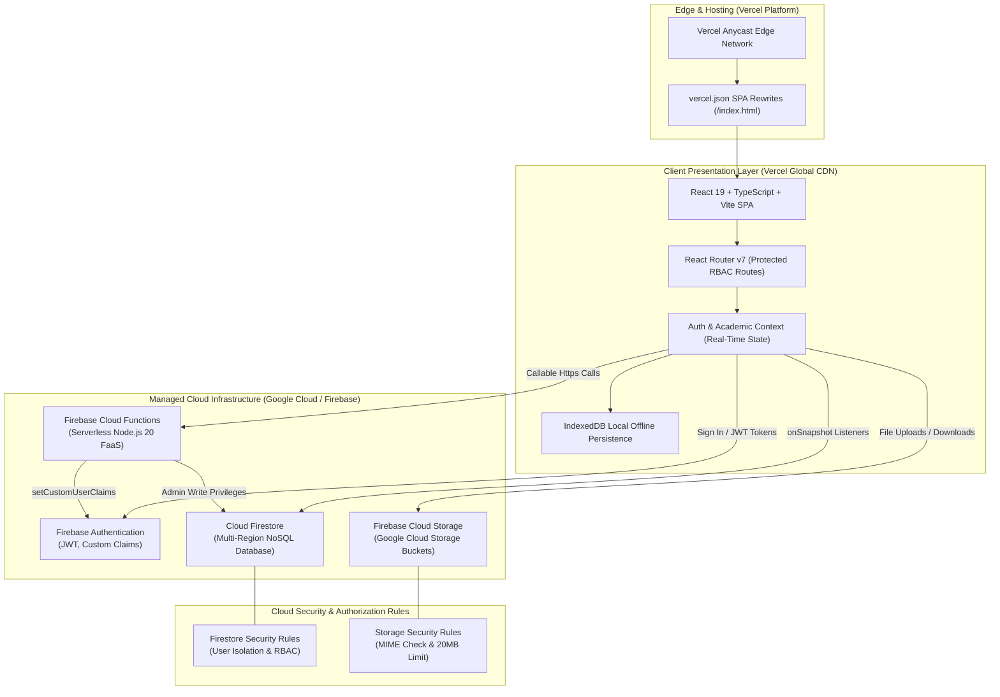
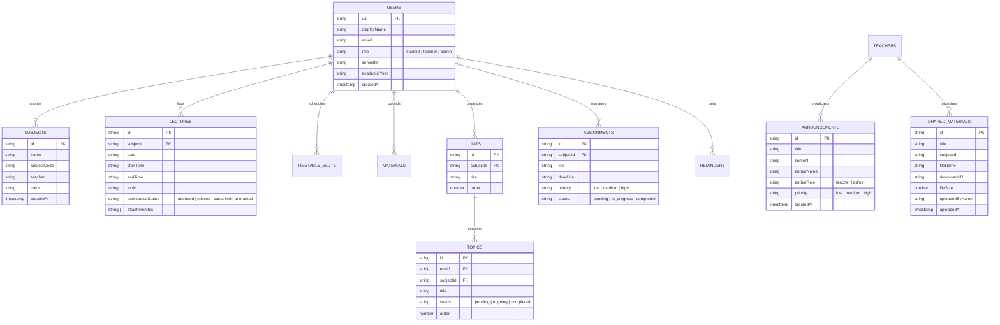

# LifeLog: Cloud-Based Academic Management & Real-Time Coursework Platform
## Academic Project Report & Demonstration Guide
**Domain:** Education | Cloud Computing & Full-Stack Application Development  
**Academic Guidelines Compliance:** CCSA Guidelines for Cloud-Based Full Stack Projects  

---

## 1. Project Title
**LifeLog: Multi-Tenant Cloud-Based Academic Coursework Tracker with Real-Time State Synchronization and Role-Based Access Control**

---

## 2. Problem Statement
In contemporary higher education, students and faculty face severe fragmentation across disjointed tools:
- Lecture records, attendance tallies, and daily class notes are tracked in paper notebooks or disparate personal note apps.
- Official course materials (lecture slide decks, syllabi, and reading packets) are scattered across email threads, cloud drives, and instant messaging channels.
- Assignment deadlines, submission checkpoints, and syllabus completion metrics lack unified, real-time visibility.
- Traditional academic portals suffer from high latency, stale page caches requiring manual page refreshes, lack of real-time multi-device synchronization, and inadequate role-based boundary enforcement between students, educators, and administrators.

---

## 3. Existing System and Its Limitations
### Existing Academic Record Systems:
1. **Manual / Spreadsheet Tracking:**
   - Prone to data loss, lack of automated backups, and inaccessible across mobile/desktop environments simultaneously.
2. **Monolithic Legacy Learning Management Systems (LMS):**
   - High compute overhead, monolithic relational database locking, slow load times, and absence of instantaneous WebSocket/reactive data streaming.
3. **General Note-Taking Applications (Notion, Google Keep, Evernote):**
   - Lack academic-specific domain modeling (timetable slot mapping, attendance status tracking, syllabus unit-topic hierarchies, assignment deadline prioritization).
   - No built-in role separation (Student vs. Teacher vs. Administrator) tailored for educational cohorts.

---

## 4. Proposed Solution
**LifeLog** is a full-stack, cloud-native academic platform engineered on modern cloud principles:
- **Reactive Real-Time Synchronization:** Employs Cloud Firestore real-time listeners (`onSnapshot`) to deliver sub-second state propagation across devices without manual polling or browser refreshes.
- **Strict Role-Based Access Control (RBAC):** Implements a three-tier permission model (**Student**, **Teacher**, **Admin**) enforced cryptographically via Firebase Authentication Custom Claims and server-side Firestore/Storage Security Rules. Client-submitted role manipulation is strictly prevented.
- **Serverless Cloud Compute:** Leverages Firebase Cloud Functions to execute sensitive administrative actions (role provisioning, claims management, institutional aggregations) in a secure Node.js execution environment.
- **Scalable Object Storage:** Firebase Cloud Storage with strict byte-size limits (under 20 MB) and MIME-type validation for academic document formats (PDF, PPT, PPTX, DOC, DOCX, and images).
- **Edge-Optimized Single Page Application (SPA):** Built with React 19, Vite, TypeScript, and Tailwind CSS, deployed on Vercel's global Content Delivery Network (CDN) with automated caching headers and client-side route rewrites.

---

## 5. Project Objectives
1. Design and deploy a responsive, cloud-native web application tailored to the **Education** domain.
2. Implement **real-time bi-directional data synchronization** for lecture notes, syllabus completion progress, assignments, and faculty announcements.
3. Enforce **least-privilege cloud security** using server-side Security Rules across Cloud Firestore and Firebase Cloud Storage.
4. Establish trusted **Role-Based Access Control (RBAC)** guaranteeing that student data remains isolated while faculty can broadcast materials and administrators can manage institutional parameters.
5. Demonstrate core cloud computing concepts: Multi-Tenancy, Backend-as-a-Service (BaaS), Function-as-a-Service (FaaS), Edge Delivery, and Offline-Aware Client Caching.
6. Achieve production deployment on **Vercel** with full SPA rewrite configuration and secure environment variable handling.

---

## 6. Target Users
1. **Students:** Enrolled undergraduate and graduate students managing semester subjects, daily timetable logs, lecture notes, syllabus topics, assignments, and study materials.
2. **Teachers / Faculty Members:** Instructors and professors who publish verified course syllabi, lecture presentations, and broadcast critical academic notices.
3. **Institutional Administrators:** Academic coordinators or department heads managing user identities, verifying role elevations, and configuring academic semester calendars.

---

## 7. Functional Requirements

### 7.1 Student Functionality
- **Authentication:** Secure account registration and email/password sign-in. Default role is strictly locked to `student`.
- **Subject Management:** Create and organize subjects with custom codes, instructor names, color coding, and descriptions.
- **Timetable Configuration:** Weekly recurring lecture slot scheduling (day, start time, end time, room number).
- **Daily Class Log:** Record lecture topics, rich lecture summaries, homework checkpoints, and attendance status (`attended`, `missed`, `cancelled`, `unmarked`).
- **Document & Material Storage:** Upload PDF, PPT, and DOC attachments directly linked to subjects or specific lectures.
- **Syllabus Tracker:** Create Units and Topics; toggle progress dynamically between `pending`, `ongoing`, and `completed`.
- **Assignment Tracker:** Create assignments with priority (`low`, `medium`, `high`), due dates, status lifecycle (`pending`, `in_progress`, `completed`), and attached question papers.
- **Real-Time Notification & Reminders:** Set reminders for upcoming exams, assignment deadlines, or syllabus revision.
- **Paginated Document View:** Pagination controls for lecture collections and document libraries to prevent large payloads.

### 7.2 Teacher Functionality
- **Faculty Portal:** Dedicated workspace to manage course materials and notifications.
- **Broadcast Announcements:** Create high-, medium-, and low-priority academic notices with instant real-time broadcast to all enrolled student dashboards.
- **Shared Material Repository:** Upload lecture slide decks (PPT/PPTX) and reference guides (PDF/DOC) accessible across the student cohort.
- **Curriculum Monitoring:** Inspect syllabus coverage and topic completion stats across subjects.

### 7.3 Administrator Functionality
- **Admin Portal & RBAC Registry:** Live directory of all registered users displaying Name, Email, Semester, and assigned Role.
- **Role Elevation & Demotion:** Promote users to `teacher` or `admin`, or demote to `student`.
- **Cloud Architecture Telemetry:** Live health monitor verifying status of Firebase Authentication, Cloud Firestore, Firebase Storage, Cloud Functions, and Vercel CDN.
- **Institutional Configuration:** Configure institutional parameters, active academic year (e.g., 2026–2027), and active semester term.
- **Evaluator Demonstration Switcher:** In-app role toggle enabling academic evaluators to verify RBAC enforcement across all 3 user roles instantly.

---

## 8. Non-Functional Requirements
- **Availability:** High availability backed by Google Cloud's multi-region infrastructure and Vercel's global Anycast Edge network.
- **Scalability:** Horizontal scaling of Cloud Firestore and Firebase Cloud Functions without manual server provisioning.
- **Performance:** Sub-second page loads; compressed chunk size; assets cached with `Cache-Control: public, max-age=31536000, immutable`.
- **Data Integrity & Security:** Least-privilege Firestore rules preventing unauthorized cross-user reads/writes; strict MIME type and 20MB file validation.
- **Usability & Responsiveness:** Intuitive UI rendered with Tailwind CSS, supporting mobile, tablet, and desktop layouts with collapsible navigation.
- **Offline Resilience:** Local state caching in IndexedDB enabling offline lecture recording with auto-synchronization when reconnected.

---

## 9. System Architecture



---

## 10. Technology Stack
| Layer | Technology | Version | Purpose |
| :--- | :--- | :--- | :--- |
| **Frontend Framework** | React | 19.3.1 | Component-driven declarative UI |
| **Build Tool** | Vite | 8.3.8 | High-speed ESM bundling and HMR |
| **Language** | TypeScript | 7.0.2 | End-to-end static typing and type safety |
| **Styling** | Tailwind CSS | 4.3.5 | Modern utility-first responsive styling |
| **Routing** | React Router DOM | 7.18.5 | Client-side routing with RBAC guards |
| **Icons** | Lucide React | 1.72.0 | Modern SVG iconography |
| **Cloud Authentication** | Firebase Auth | 13.3.0 | Identity management & Custom Claims |
| **Cloud Database** | Cloud Firestore | 13.3.0 | Multi-tenant NoSQL real-time document store |
| **Object Storage** | Firebase Cloud Storage | 13.3.0 | Cloud document and image repository |
| **Serverless Compute** | Firebase Cloud Functions | 6.0.1 | Backend serverless business logic |
| **Admin SDK** | Firebase Admin | 12.7.0 | Server-side cryptographic claim assignment |
| **Edge Deployment** | Vercel Platform | Latest | Global CDN, HTTPS, and SPA delivery |

---

## 11. Firebase Services Used
1. **Firebase Authentication:**
   - User identity lifecycle (Registration, Password Reset, Login, Session Persistence).
   - Cryptographic JWT tokens with server-verified Custom Claims (`role: 'student' | 'teacher' | 'admin'`).
2. **Cloud Firestore:**
   - Multi-tenant hierarchical NoSQL database.
   - Real-time synchronization via WebSocket data streams (`onSnapshot`).
   - Composite indexes for multi-field queries.
3. **Firebase Cloud Storage:**
   - Scalable object storage for binary assets (PDFs, PPT slide decks, Word documents, images).
   - Direct-to-cloud resumable uploads with download URLs.
4. **Firebase Cloud Functions (FaaS):**
   - Serverless compute executed in isolated Node.js 20 containers.
   - Handlers for `setUserRole` (admin claims setup), `onUserCreated` (auto student initialization), and `getSystemSummary` (aggregate telemetry).

---

## 12. Cloud Computing Concepts Demonstrated
1. **Multi-Tenancy & Data Isolation:**
   - Individual student data is isolated under `/users/{userId}/*` subcollections. Firestore security rules prevent cross-tenant data leakage.
2. **Backend-as-a-Service (BaaS):**
   - Eliminates traditional self-hosted database servers, patching, and OS maintenance through fully managed database and storage services.
3. **Function-as-a-Service (FaaS) / Serverless Compute:**
   - Cloud Functions spin up on demand to execute administrative tasks and scale down to zero when idle, optimizing cost and compute footprint.
4. **Real-Time State Synchronization (Reactive Architecture):**
   - Employs Firestore real-time snapshot listeners so changes made on one client (e.g., faculty posting an announcement or marking a syllabus topic completed) propagate instantaneously across all connected devices.
5. **Edge Computing & Global CDN Delivery:**
   - Application frontend assets are distributed across Vercel’s global Edge nodes, minimizing round-trip times (RTT) and latency.
6. **Least Privilege Security Architecture:**
   - Security enforced at the database and storage rule level, not merely on the client. Unauthenticated or unauthorized API calls are blocked at the cloud boundary.
7. **Offline-Aware Local State (IndexedDB Cache):**
   - Client can read and write data during intermittent connectivity; offline writes are queued and synchronized with Cloud Firestore upon reconnection.

---

## 13. Database Design

### 13.1 Entity Relationship Diagram (ERD)



### 13.2 Firestore Collection Structure
- `/users/{userId}`: User profile document with trusted `role` attribute.
  - `/users/{userId}/subjects/{subjectId}`: Student subject catalogue.
  - `/users/{userId}/lectures/{lectureId}`: Lecture attendance and topic log.
  - `/users/{userId}/timetable/{slotId}`: Weekly recurring slot configuration.
  - `/users/{userId}/materials/{materialId}`: Personal lecture attachments metadata.
  - `/users/{userId}/units/{unitId}`: Syllabus curriculum modules.
  - `/users/{userId}/topics/{topicId}`: Topic checkpoints with completion status.
  - `/users/{userId}/assignments/{assignmentId}`: Academic coursework items.
  - `/users/{userId}/reminders/{reminderId}`: Date/time notifications.
- `/announcements/{announcementId}`: Global/subject announcements published by Faculty and Admins.
- `/sharedMaterials/{materialId}`: Course materials published by Faculty.
- `/systemConfig/academic`: Global academic year and term parameters.

---

## 14. Security Considerations
1. **Frontend Role Distrust:**
   - Role submitted in frontend payloads is never trusted. New registrations default to `student`. Only an `admin` or a serverless Cloud Function with Firebase Admin credentials can modify a user's role.
2. **Firestore Security Rules:**
   - User profile update rules enforce that `role` cannot be modified by the user:
     ```javascript
     allow update: if (isOwner(userId) && (!request.resource.data.diff(resource.data).affectedKeys().hasAny(['role', 'email']))) || isAdmin();
     ```
3. **Storage Rules Security:**
   - Strictly enforces file sizes under 20 MB: `request.resource.size < 20 * 1024 * 1024`.
   - MIME whitelist verifies content types for PDFs, Microsoft Office documents, PowerPoint presentations, and standard web images.
4. **No Secret Leakage:**
   - Zero Firebase Admin SDK credentials or service account private keys are present in client code. Only client-safe environment variables prefixed with `VITE_` are exposed.

---

## 15. Deployment Procedure

### 15.1 Frontend Deployment on Vercel
1. **Push Source Code to GitHub:**
   ```bash
   git add .
   git commit -m "feat: complete academic platform"
   git remote add origin https://github.com/<username>/lifelog.git
   git push -u origin master
   ```
2. **Import Repository in Vercel:**
   - Navigate to [Vercel Dashboard](https://vercel.com/new).
   - Select the GitHub repository `lifelog`.
   - Framework Preset: **Vite**.
   - Build Command: `npm run build`.
   - Output Directory: `dist`.
3. **Set Environment Variables in Vercel:**
   - In Project Settings -> **Environment Variables**, add the 6 Firebase keys:
     - `VITE_FIREBASE_API_KEY`
     - `VITE_FIREBASE_AUTH_DOMAIN`
     - `VITE_FIREBASE_PROJECT_ID`
     - `VITE_FIREBASE_STORAGE_BUCKET`
     - `VITE_FIREBASE_MESSAGING_SENDER_ID`
     - `VITE_FIREBASE_APP_ID`
4. **Verify SPA Routing (`vercel.json`):**
   - The included `vercel.json` ensures all deep routes (`/log`, `/subjects`, `/teacher`, `/admin`) are rewritten to `/index.html` for client-side routing.
5. **Deploy & Validate:**
   - Click **Deploy**. Vercel produces an HTTPS URL (e.g., `https://lifelog-alpha.vercel.app`).

### 15.2 Firebase Cloud Rules & Functions Deployment
1. **Login & Initialize Firebase CLI:**
   ```bash
   firebase login
   firebase use <your-project-id>
   ```
2. **Deploy Security Rules and Indexes:**
   ```bash
   firebase deploy --only firestore:rules,firestore:indexes,storage:rules
   ```
3. **Deploy Serverless Cloud Functions:**
   ```bash
   firebase deploy --only functions
   ```

---

## 16. Limitations
1. **Web-Based Presentation Viewer:** High-fidelity animations in `.pptx` files require native desktop software; the web viewer renders slides via standard browser document rendering.
2. **Simulated Institutional SIS Integration:** In the absence of an institutional LDAP/Active Directory endpoint, user registration relies on Firebase Authentication email/password.
3. **Client File Upload Quotas:** Maximum file size is capped at 20 MB to protect student bandwidth and cloud bucket quotas.

---

## 17. Future Enhancements
1. **Automated Attendance Aggregates & Low Attendance Alerts:** Push notifications via Firebase Cloud Messaging (FCM) when attendance falls below 75%.
2. **AI-Powered Lecture Summarization:** Integration of Gemini API via Cloud Functions to generate flashcards and revision quizzes from uploaded lecture notes.
3. **Turnitin / Plagiarism Analysis Hook:** Cloud Function trigger to scan submitted assignment documents against reference material repositories.
4. **Offline PWA with Service Workers:** Full Progressive Web App (PWA) manifest enabling installation as a desktop and mobile app with background sync.

---

## 18. Demonstration Plan (Viva & Evaluation Guide)

| Step | Action | Feature Highlighted | Expected Result |
| :--- | :--- | :--- | :--- |
| **1. Registration & Login** | Navigate to `/signup`, register a new user account, sign in. | Firebase Authentication & Role Initialization | User is authenticated; Firestore profile initialized with default role `student`. |
| **2. Adding a Subject** | Navigate to `/subjects`, click **New Subject**, enter "Cloud Computing", code "CC501", teacher name, and select a color. | Firestore Document Creation & State Management | Subject card appears immediately in subject catalogue. |
| **3. Configuring Timetable** | In Daily Class Log (`/log`), click **Timetable**, add a slot for Monday 09:00–10:00 AM, Room 302. | Relational Slot Mapping | Timetable slot is saved and auto-populates "Today's classes" on dashboard on Mondays. |
| **4. Recording a Lecture** | On `/log`, click **Record Lecture**, enter topic "Distributed Storage Systems", mark attendance as "Attended", and write notes. | Real-Time Lecture Log | Lecture saved, attendance statistics update dynamically. |
| **5. Uploading PDF/PPT** | Navigate to `/notes`, select "Cloud Computing", upload a `.pdf` syllabus or `.pptx` presentation. | Cloud Storage Upload & MIME/Size Validation | File uploaded to Firebase Storage, download URL generated, preview modal displays document. |
| **6. Tracking Syllabus** | Navigate to `/syllabus`, add Unit 1 "Virtualization", add topic "Hypervisors", toggle status from Pending to Completed. | Dynamic Real-Time Aggregation | Topic marked completed; dashboard syllabus completion % recalculates in real-time. |
| **7. Creating an Assignment** | Navigate to `/assignments`, add "Cloud Lab Assignment 1", set High Priority and deadline. | Coursework Tracking | Assignment listed under Pending Assignments; deadline highlighted. |
| **8. Real-Time Sync** | Open the application in two browser windows side by side. Add a lecture note in window A. | Firestore `onSnapshot` Streaming | Window B immediately displays the new lecture note without refreshing. |
| **9. RBAC & Access Restrictions** | In `/settings` or `/admin`, use the Evaluator Role Switcher to toggle to **Teacher** then **Admin**. | Role-Based Access Control (RBAC) | Teacher Portal (`/teacher`) and Admin Portal (`/admin`) become accessible; unauthorized users are redirected. |
| **10. Public Deployment** | Open the live Vercel HTTPS URL, navigate through deep links, test session persistence. | Production Vercel Edge Hosting | Application runs seamlessly with clean SPA client routing and cloud persistence. |

